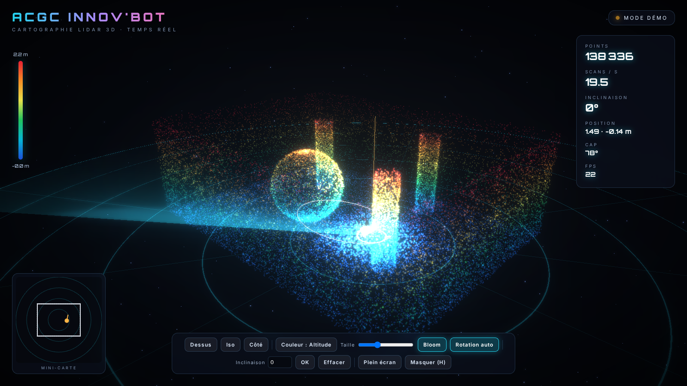
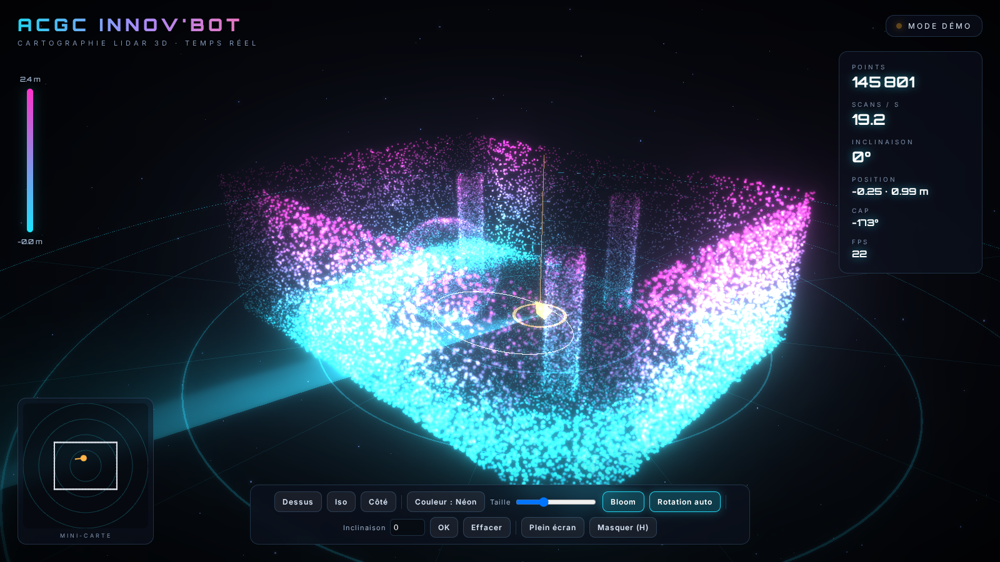
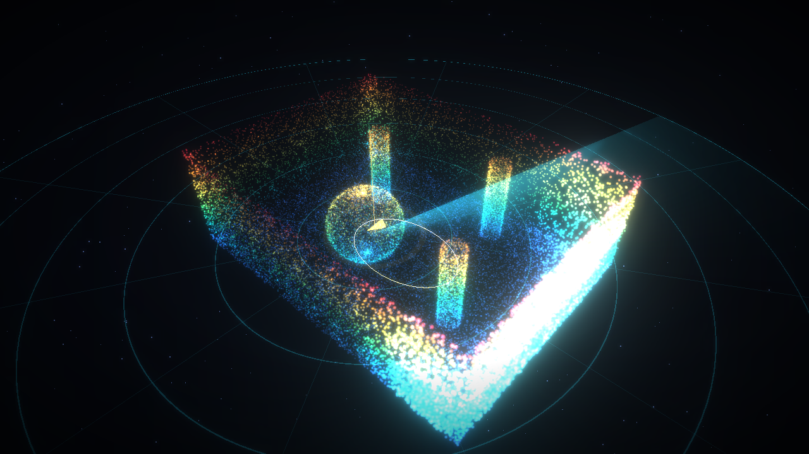
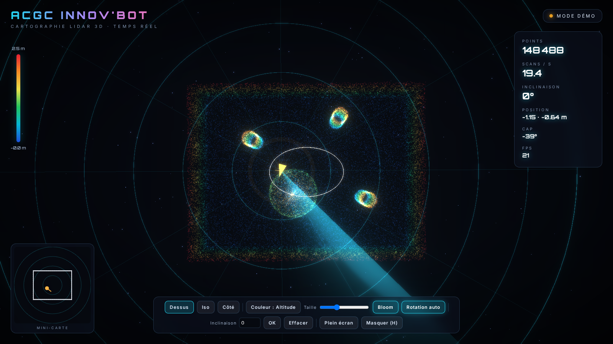

# Robot patrouilleur cartographe (LiDAR LD14P)

Robot mobile qui scanne son environnement à 360° avec un **LiDAR LDROBOT LD14P** et affiche la carte en **3D temps réel** dans un navigateur.

Projet réalisé par **Adja Cheikh Gatta Camara**, étudiante en Licence Robotique et Sciences émergentes (UNCHK, Sénégal), au sein de **ACGC Innov'Bot**.

## Aperçu

Vidéo du dashboard : [apercu_dashboard_lidar_3d.mp4](apercu_dashboard_lidar_3d.mp4)

## Fonctionnalités

- Pilote série du LD14P (230400 bauds) avec vérification CRC8 des trames
- Reconstruction d'un scan complet (un tour de 360°) à partir des trames
- Dashboard web 3D servi par un serveur HTTP Python : réglage de la portée, plusieurs vues et palettes, mode kiosque

## Matériel

- LiDAR LDROBOT LD14P
- Raspberry Pi 3
- Carte de contrôle moteurs SB Components Motor Shield
- Châssis, moteurs et batterie : à compléter

## Technologies

Python 3 · pyserial · HTTP (`http.server`) · JavaScript

## Installation et lancement

    pip install -r requirements.txt
    python3 dashboard_lidar.py /dev/ttyUSB0

Puis ouvrir http://localhost:8000 dans un navigateur. Sans argument, le port série par défaut est `/dev/ttyUSB0`.

Le serveur écoute sur toutes les interfaces réseau (`0.0.0.0`) : ne pas l'exposer sur un réseau public.

## Structure

- `ld14p.py` : pilote du LiDAR (décodage des trames, scans)
- `dashboard_lidar.py` : serveur et dashboard 3D
- `apercu_*.png` : captures du dashboard

## État du projet

- Le robot a été réalisé et testé physiquement. Le code d'origine tournait sur le Raspberry Pi, restitué après le projet.
- `ld14p.py` est une **réécriture** du pilote d'après le protocole public du LD14P. Il est vérifié sur des trames simulées (CRC et décodage), mais n'a pas été retesté sur le capteur réel.
- Contrôle des moteurs : bibliothèque [sbcshop/MotorShield](https://github.com/sbcshop/MotorShield) (SB Components), non incluse dans ce dépôt.

## Crédits

- Motor Shield : [SB Components](https://github.com/sbcshop/MotorShield)
- LiDAR LD14P : LDROBOT

## Licence

MIT, voir [LICENSE](LICENSE).
